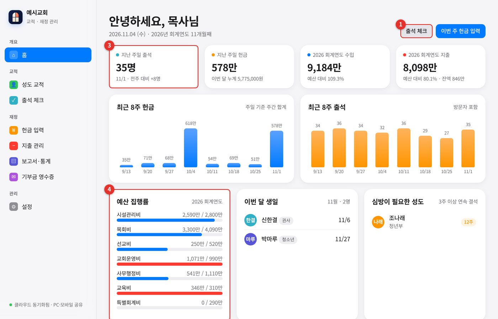
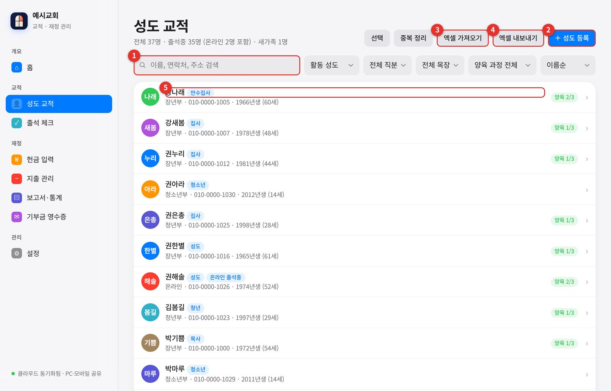
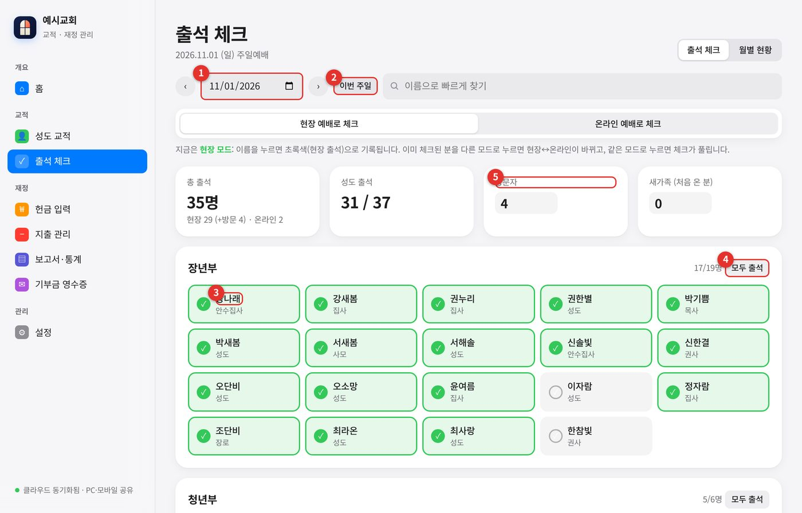
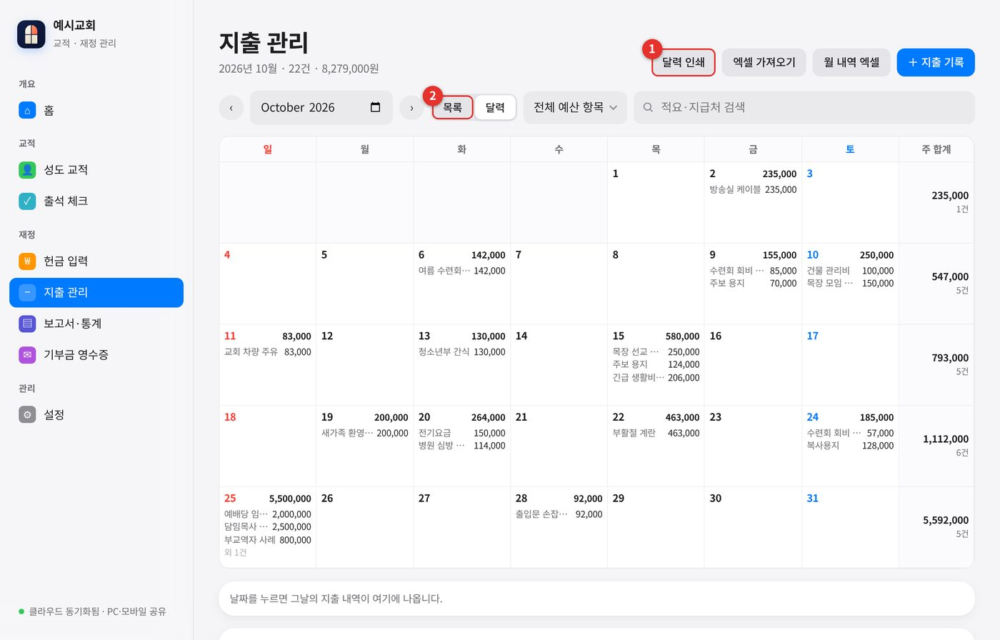
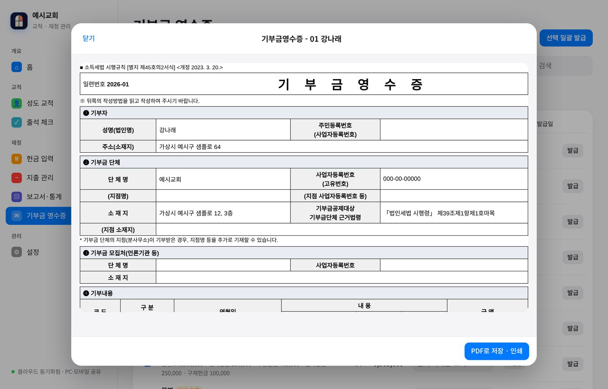
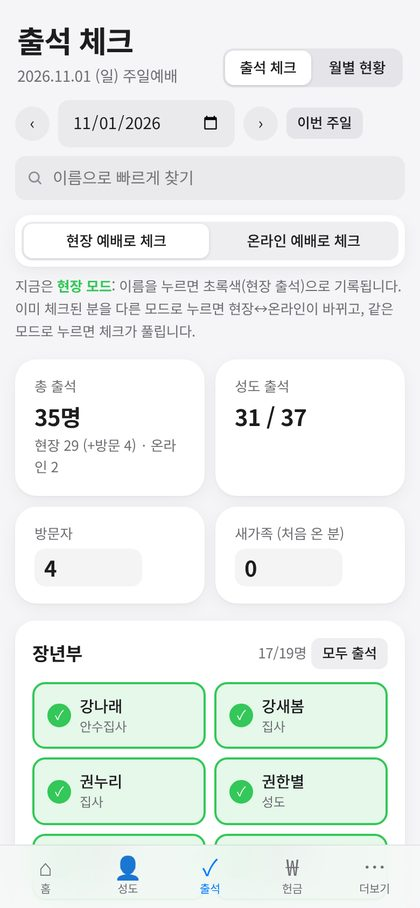

# 바나바 — 교적 · 재정 · 목양 도우미

**작은 교회를 위한 무료 교적·출석·헌금·지출·보고서 앱**

성도 명단, 주일 출석, 헌금 입력, 지출 관리, 분기·연간 보고서, 기부금 영수증과 홈택스 일괄발급 파일까지. 경기 화성 [다시본교회](https://dasibon.icg21.com/)가 12년 동안 직접 쓰며 다듬은 도구를, 다른 교회와 나누려고 공개합니다.

**현재 버전: 1.2.1** (2026-11-10) · [업데이트 기록](CHANGELOG.md) · [설치와 업데이트](docs/설치와-업데이트.md)

- 사용료는 없습니다. **교회와 비영리 단체**는 누구나 무료로 쓸 수 있습니다. ([사용 허락](LICENSE))
- 앱은 파일 하나(`church-app.html`)입니다. 서버를 따로 빌리지 않습니다.
- 자료는 **내 Claude 계정**에 저장됩니다. 만든 사람의 서버로 보내지 않습니다.
- 주민등록번호는 저장하지 않습니다.

> **먼저 읽어 주세요.** 이 앱은 Claude **유료 구독(Pro 이상)** 계정에서 돌아갑니다. 자료 저장과 구글 백업 기능을 Claude가 제공하기 때문입니다. 설치 방법은 아직 시험 중입니다. 구독하지 않는 분을 위한 버전은 준비 중입니다.

*그림의 이름과 금액은 모두 가상의 '예시교회' 자료입니다.*

## 왜 이름이 ‘바나바’인가요?

바나바는 성경 속 인물로, 이름의 뜻이 **‘위로의 아들’**(행 4:36)입니다. 늘 사람 곁에서 세워 주는 도우미였습니다.

- **재정으로 섬겼습니다.** 자기 밭을 팔아 그 값을 사도들 앞에 가져다 놓았습니다. (행 4:36-37)
- **사울(바울)을 맨 먼저 믿어 주었습니다.** 모두가 두려워할 때 사도들에게 데려갔습니다. (행 9:27)
- **실패한 마가를 끝까지 품었습니다.** (행 15:37-39)

이 앱도 목회자 앞에 나서는 프로그램이 아니라, 성도의 이름과 헌금과 지출을 차근차근 기록하며 곁에서 돕는 도우미가 되기를 바라며 이름을 지었습니다.

## 무엇을 할 수 있나요

| 기능 | 설명 |
|---|---|
| 성도 교적 | 이름·연락처·직분·목장·양육 과정을 한 화면에서 찾고 고칩니다. 엑셀 가져오기·내보내기, 삭제 대신 ‘보관’, **같은 이름 성도 A·B 자동 구별**, 음력 생일 |
| 출석 체크 | 주일 명단에서 이름을 눌러 기록합니다. 온라인 출석도 따로 세고, ‘입력 완료’를 눌러야 통계에 반영됩니다 |
| 헌금 입력 | 빠른 입력(‘5만’, ‘3.5만’), 현장·계좌이체 구분, 계수 보고서 PDF, **명단에 없는 헌금자를 교적에 등록** |
| 지출 관리 | 예산 항목별 기록, 월 달력, A4 한 장 인쇄, 영수증 사진 보관 |
| 보고서·통계 | 분기·연간 결산, 성도별 헌금·출석, 연도별 비교 |
| 기부금 영수증 | 영수증 PDF, 홈택스 일괄발급 엑셀 파일(시험 기능) |
| 심방·양육 | 심방 일지, 6개월 넘게 못 만난 성도 알림, 일대일 양육 진도 |
| 주간 마감 | 현장·계좌이체 합계를 자동으로 합산해 확인한 뒤 그 주의 헌금·지출을 잠그고, 고칠 때는 사유를 남기고 해제 |
| 안전한 백업 | **암호 걸어 백업**, **백업 알림(한 달에 한 번)**, **자료 대조**, **변경 이력**, 복구 지점(최근 60일), 구글 드라이브 자동 백업 |

굵은 글씨는 1.2.1 버전에서 새로 생겼거나 달라진 기능입니다.

휴대폰에서도 같은 자료가 보입니다. 주일 현장에서는 출석 체크가 편합니다.

## 설치

1. 이 저장소의 [Releases](../../releases/latest)에서 **church-app.html**을 내려받습니다.
2. Claude에서 새 대화를 열고 그 파일을 첨부한 뒤, [설치와 업데이트](docs/설치와-업데이트.md)의 요청문을 붙여넣어 보냅니다.
3. 앱이 열리면 설정 → 교회 정보를 입력하고 저장합니다.

자세한 그림 설명은 **[사용 설명서 PDF](docs/사용매뉴얼.pdf)** (53쪽)를 보세요. 1.2.1에서 새로 생기거나 바뀐 부분은 설명서 19장에 모았습니다.

## 업데이트하기

1. 설정 → 백업·자료에서 **전체 백업(JSON)** 을 받습니다.
2. 새 `church-app.html`을 첨부하고 [설치와 업데이트](docs/설치와-업데이트.md)의 업데이트 요청문을 보냅니다. 저장된 자료는 건드리지 않고 앱 파일만 바뀝니다.
3. 설정 → 앱 정보에서 버전을 확인하고, **자료 대조**로 자료가 그대로인지 확인합니다.

> 1.2.0에서 1.2.1로 올리면 같은 이름의 성도에게 A, B 이름표가 자동으로 붙습니다. 자료가 바뀐 것이 아니라 구별표가 붙은 것이고, 영수증에는 실명이 나옵니다.

## 새 버전 소식 받기

이 저장소 위쪽의 **Watch → Custom → Releases**를 체크하면, 새 버전이 나올 때만 GitHub 알림(메일)이 옵니다. 업데이트 전에는 꼭 전체 백업을 받으세요.

## 꼭 지켜 주세요

- 앱 링크를 **‘누구나 볼 수 있게’ 공유하지 마세요.** 성도 정보가 보일 수 있습니다. 함께 쓸 사람은 이메일로 한 사람씩 초대하세요.
- **한 달에 한 번 전체 백업**을 받아 구글 드라이브 ‘회계자료’ 폴더에 보관하세요.
- 홈택스 일괄발급 파일은 아직 실제 홈택스에서 확인하지 못한 시험 기능입니다. 세무 관련 최종 확인은 교회 재정 담당자와 세무 전문가가 하셔야 합니다.

## 사용 허락 (요약)

- 교회와 비영리 단체의 **무료 사용**만 허락합니다.
- 판매, 유료 설치·운영 대행 등 **영리 목적 사용은 금지**입니다.
- 한국 주요 교단 총회가 **이단·사이비로 결의한 단체**는 사용할 수 없습니다.
- 앱은 있는 그대로 제공되며, 세무 관련 기능은 참고용입니다.

전문은 [LICENSE](LICENSE)에 있습니다. 사용 대상을 제한했기 때문에 OSI 기준의 오픈소스 라이선스는 아닙니다. 소스를 공개하고 교회가 무료로 쓰게 하는 **소스 공개 무료 사용 허락**입니다. 이 허락서는 법률 검토 전의 초안입니다.

## 참여하기

- 오류나 제안은 [Issues](../../issues)에 남겨 주세요. **성도 이름, 연락처, 주민등록번호가 보이는 화면은 올리지 마세요.** ([CONTRIBUTING](CONTRIBUTING.md))
- 보안 문제는 공개로 올리지 말고 [SECURITY](SECURITY.md)를 따라 알려 주세요.
- 이 앱이 쓰는 개인정보와 외부 연결은 [PRIVACY](PRIVACY.md)에 적었습니다.

## 만든 사람

다시본교회 담임 주진규 목사

[교회 홈페이지](https://dasibon.icg21.com/) · [웹주보](https://dasibon-church.jinkyuju.workers.dev/) · [유튜브](https://www.youtube.com/@dasibon)

사용한 외부 소프트웨어는 [THIRD_PARTY_NOTICES.md](THIRD_PARTY_NOTICES.md)에 적었습니다.
